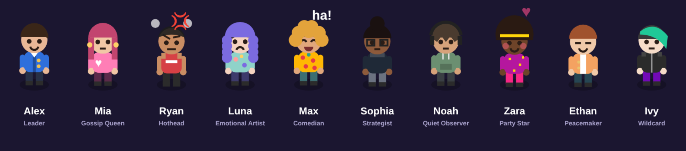
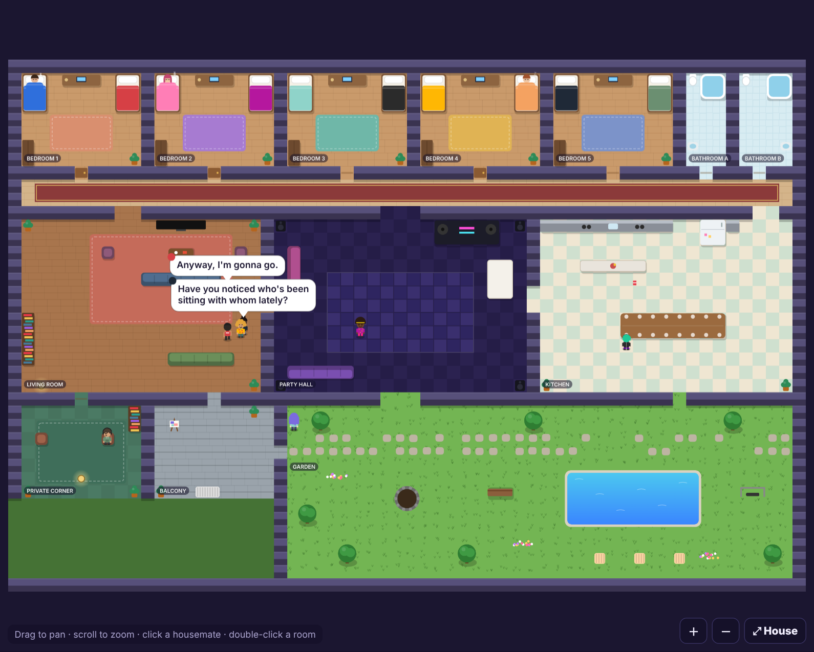
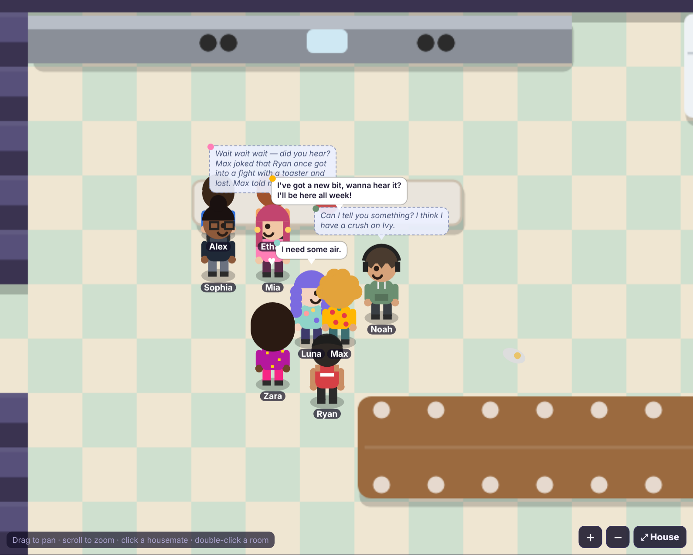
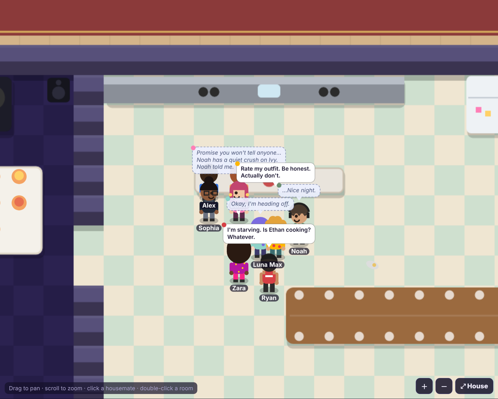
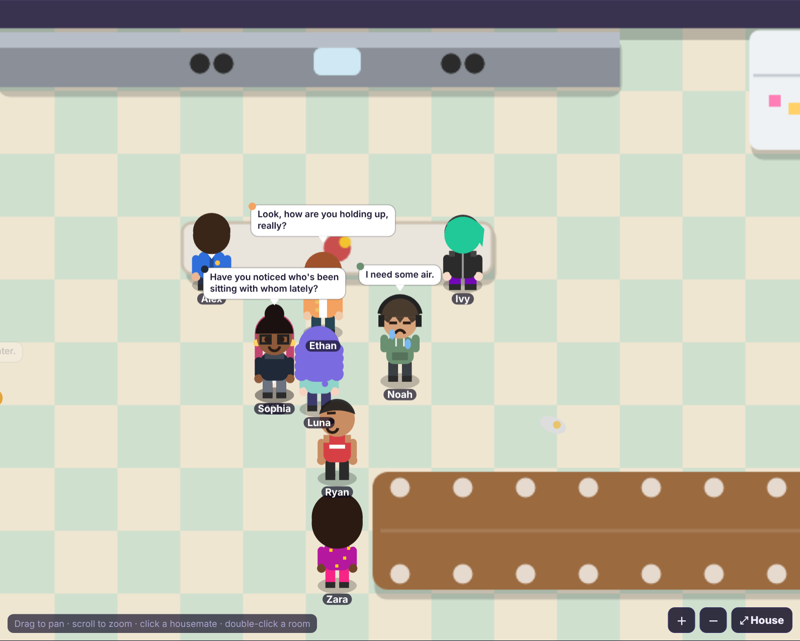
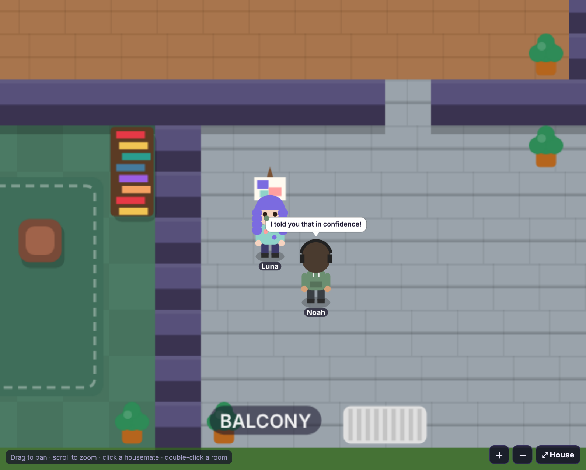
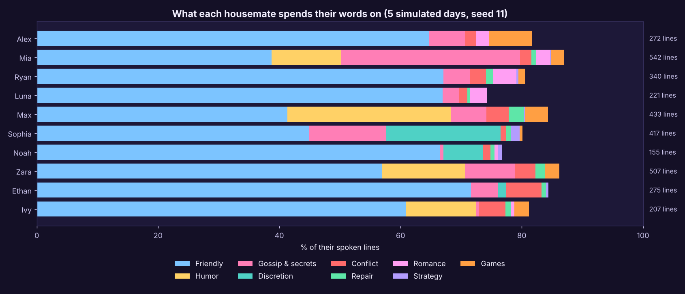
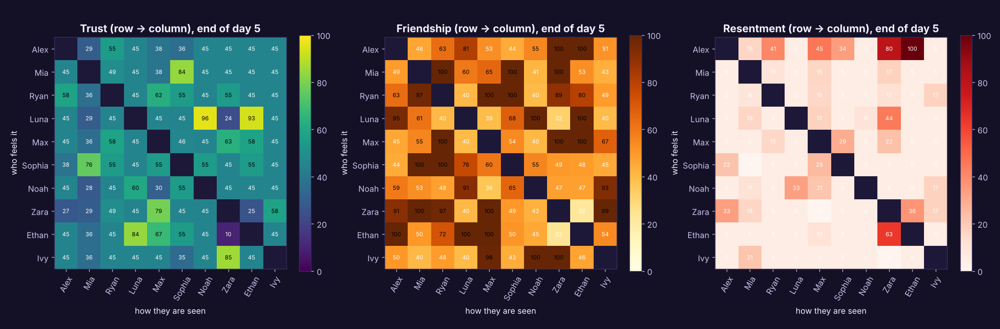

# 🏠 The Gossip House
### Ten AI housemates. One house. No script.

**▶ [Play it live in your browser](https://gowtham2507.github.io/the-ai-gossip-house/)** · [Behaviour report](docs/BEHAVIOR_REPORT.md) · [How it works](docs/ALGORITHMS.md)

A browser-based reality-show simulation. Ten autonomous AI agents share a house and live their lives on their own: they talk, gossip, flirt, throw parties, keep and break secrets, fight, cry, comfort each other and make up.

The viewer is an **observer, not a director**. Every action comes from the character's own personality, emotions, needs, memories, relationships and private knowledge.





## 📖 What happened when we let them loose

> On day 4 Noah whispered his crush on Ivy to Luna in a crowded kitchen. Five people overheard. Mia passed it on within five minutes, and Noah overheard *her*. He blamed Luna (she was innocent), broke down crying, and **Luna was the one who came to comfort him**. Half an hour later he confronted her on the balcony: *"I told you that in confidence!"* She said *"That wasn't me,"* and he chose to believe her. Their friendship survived, but his trust in her didn't fully recover.

| | |
|---|---|
|  |  |
|  |  |

**Read the full behaviour report → [docs/BEHAVIOR_REPORT.md](docs/BEHAVIOR_REPORT.md)**: the story above, a profile of every character, the time each spent on each activity, relationship heatmaps, how each secret spread, and the weaknesses we found.

| | |
|---|---|
|  |  |

## Features

- **10 distinct characters:** Alex, Mia, Ryan, Luna, Max, Sophia, Noah, Zara, Ethan and Ivy. Each has a unique look, personality traits, a speech style, goals and secrets.
- **A 2D top-down house:**
  - 5 bedrooms, 2 bathrooms, a living room, a party hall, a kitchen, a private corner, a balcony and a garden.
  - Characters walk between rooms using A* pathfinding.
  - Day/night lighting, party lights, storms and power outages.
- **Autonomous agents:** each agent picks its own activity through utility-based decisions, and stores the reason it chose.
- **Real AI dialogue:**
  - Lines are generated by Claude (through the claude.ai artifact `sample` capability) and checked against a schema.
  - Invalid replies are retried a limited number of times.
  - A built-in offline dialogue engine writes the line when Claude is unavailable.
- **Gossip with provenance:** every piece of information records who knows it, who they heard it from, how sure they are, and who they promised not to tell.
- **Spatial overhearing:** whether someone hears a line depends on distance, whispering or shouting, walls, open or closed doors, and party noise.
- **An emotion engine:** 11 emotions on a 0–100 scale, scaled by personality, that decay back to a personal baseline.
- **A relationship engine:** each relationship is one-directional (A's view of B can differ from B's view of A) and tracks trust, friendship, attraction, respect, resentment and familiarity. Every change records its cause.
- **Emergent stories:**
  - Parties, Truth or Dare, and confrontations followed by apologies and forgiveness.
  - Crying and comforting, peacemaking, alliances, flirting, confessions and couples.
  - Jealousy, and secret leaks that lead to betrayal.
- **Observer UI:**
  - Follow or inspect any agent, including the reason behind their latest decision.
  - A live event feed and full conversation transcripts that show who overheard each line.
  - Speed at 1×, 2× or 5×, and house events you can trigger.
  - Save and load.

## Quick start

No build tools or dependencies are needed.

```bash
# open the prebuilt single-file app
open dist/index.html          # macOS
xdg-open dist/index.html      # Linux
```

To rebuild after editing anything in `src/`:

```bash
python3 build.py              # concatenates src/*.js into src/shell.html → dist/index.html
```

> **Claude dialogue** works when the page runs as a claude.ai artifact that declares the `sample` capability. When opened as a plain local file, the simulation runs on the offline dialogue engine.

## Project structure

```
src/
  01_core.js       utilities, seeded RNG, house layout, furniture, A* pathfinding
  02_agents.js     the 10 character definitions, relationship seeds, initial secrets
  03_engine.js     state, emotions, relationships, memory, knowledge/gossip provenance
  04_life.js       needs, movement, activities, doors, hearing, parties, house events, tick
  05_decide.js     Layer-2 utility AI: per-agent decisions and social options
  06_conv.js       multi-agent conversation manager + social consequences of each line
  07_dialogue.js   turn planning (intent selection) + offline dialogue engine
  08_llm.js        Layer-3 LLM provider, request queue, budget, prompt builder, schema validation
  09_render.js     canvas renderer: house, furniture, animated characters, bubbles, lighting
  10_ui.js         observer UI: panels, feed, talks, camera, input, save/load, main loop
  shell.html       HTML/CSS shell
dist/index.html    built single-file app
tests/             headless simulation tests + browser tests (Playwright)
docs/              architecture, algorithms, behaviour report, test report, images
build.py           build script
```

## Documentation

- [Architecture](docs/ARCHITECTURE.md): the layered design and how the parts fit together
- [Algorithms & methods](docs/ALGORITHMS.md): the formulas and algorithms behind each system
- [Behaviour report](docs/BEHAVIOR_REPORT.md): how the agents actually behaved, with images and charts
- [Test report](docs/TEST_REPORT.md): the test methods, multi-seed statistics and known limitations

## Running the tests

```bash
node tests/run.js 3 42        # 3 simulated days, seed 42: event counts, sample conversations
node tests/stats.js 4 10      # 10 seeds × 4 days: aggregate statistics
node tests/behavior.js 11 5 > /tmp/b11.json && python3 tests/charts.py /tmp/b11.json   # behaviour study + charts
python3 tests/scenes.py       # re-render the story scenes into docs/images
pip install playwright && playwright install chromium
python3 tests/shot.py         # loads the app headless, captures screenshots, reports JS errors
python3 tests/llm.py          # tests the Claude path with a mocked sample() incl. invalid JSON
```

## Known limitations

- A hosted artifact page cannot call outside servers, so OpenAI-compatible, Groq and Ollama endpoints would need a small server-side relay. The provider layer in `08_llm.js` is the seam where that relay would plug in.
- The state is saved in browser storage or as a copyable save code, not in SQLite.
- The offline dialogue engine fills in templates. Its choices are driven by each character's state, but its wording is less varied than Claude's.
