# How the housemates behaved: a behaviour report

> **Setup:** seed 11, 5 simulated days (Day 1 08:00 → Day 6 08:00), offline dialogue engine, no viewer input.
> 465 conversations, 3,369 spoken lines, 1,019 logged events. Every image below was rendered from this same deterministic run (`tests/scenes.py`). Every number comes from `tests/behavior.js 11 5` and `tests/charts.py`.

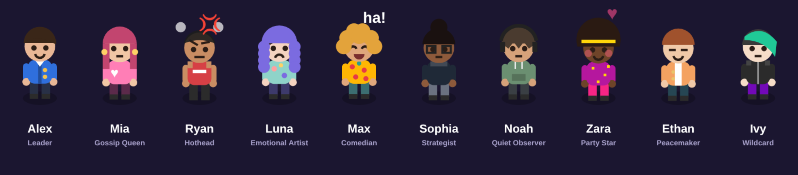

Nothing in this report was scripted. The only inputs were each character's starting personality, goals, a few initial secrets and relationships, and the simulation rules described in [ALGORITHMS.md](ALGORITHMS.md). Everything below emerged from agents making their own choices.

---

## 1. The headline story: *"I told you that in confidence!"*

This chain of events played out exactly like the gossip example in the original design brief, with one twist that no one wrote: **the wrong person got blamed.**

| Time | What happened | Why (the mechanics) |
|---|---|---|
| Day 1 08:31 | Luna confides her crush on Alex to Noah. | Luna trusts Noah (trust 82) and was feeling lonely, so the confide option scored high. |
| Day 4 14:00 | Noah, who almost never starts conversations, finally confides *his* secret to Luna: he has a crush on Ivy. He **whispers** it in the kitchen. | After days of mutual confiding, Noah's trust in Luna crossed the confide threshold. |
| Day 4 14:01 | The kitchen is crowded at lunchtime. Mia, Ryan, Max, Zara and Ethan are within whisper range and **overhear it**. | Whispers carry 2.4 tiles. Five people were standing within that radius. |
| Day 4 14:06 | Mia, the Gossip Queen (discretion 12), immediately whispers it to Sophia: *"Promise you won't tell anyone... Noah has a quiet crush on Ivy."* Sophia, the Strategist (discretion 80), replies: *"Are you sure that's even true?"* | Mia's gossip score for a juicy secret far exceeds her restraint. Sophia's high discretion makes her answer with caution. |
| Day 4 14:06 | **Noah overhears Mia spreading his secret.** | Noah was standing in the same crowded kitchen. |
| Day 4 14:06 | Noah works out who leaked it. He told only one person, Luna, so he **suspects Luna**. Luna is innocent: she kept the secret, and it escaped because Noah was overheard. | `discoverLeak()`: when the owner can't trace the source, they blame the confidant they trust least. Noah's trust in Luna drops by 24. |
| Day 4 14:35 | Max spreads it to Zara as well. Noah overhears that too and **breaks down crying**: *"finding out Max knows their secret."* | Sadness rose about 29 from the second exposure and crossed Noah's crying threshold. |
| Day 4 15:00 | **Luna, the person Noah blames, is the one who comes to comfort him**: *"It's okay to be upset. Come here."* Noah: *"That actually helps."* | Luna has empathy 85 and friendship 100 with Noah, and she noticed him crying. She doesn't know she's been blamed. |
| Day 4 15:26 | On the balcony, Noah confronts her: *"I told you that in confidence!"* Luna: *"What? That wasn't me."* Noah: *"Alright. Sorry for jumping on you."* | Luna is innocent, so the planner picks `deny`. Noah's remaining trust in her outweighs his anger, so he chooses `calm` (believe her), which restores 12 trust and removes 12 resentment. |
| End of Day 5 | Their friendship survived, but with a scar. Noah's view of Luna: friendship 91, **trust 60 (it started at 76)**, resentment 33. Luna's view of Noah: trust 96, friendship 100. | Relationships are directional and remember: one false accusation left a lasting mark on one side only. |

<table><tr>
<td>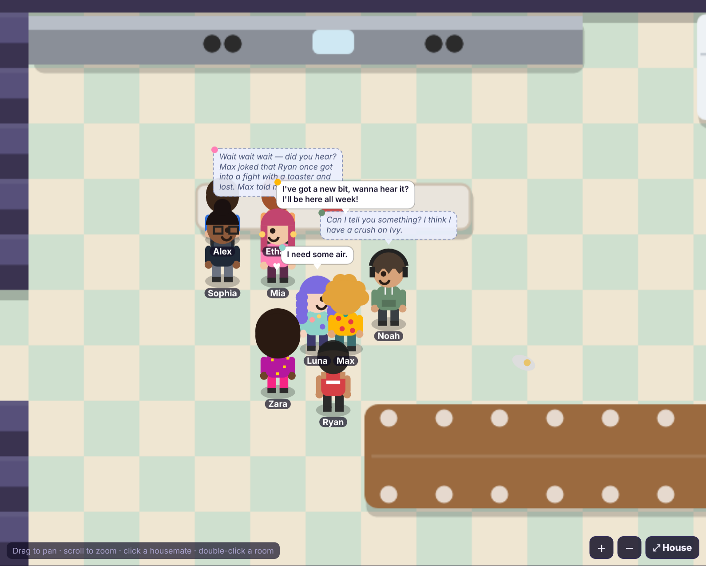 14:01: Noah whispers his secret to Luna in a busy kitchen</td>
<td>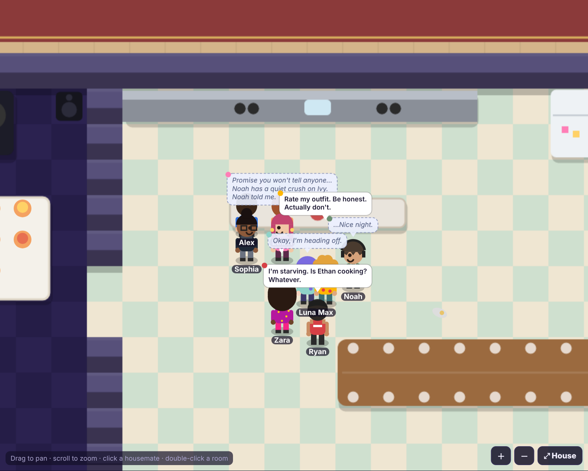 14:06: Mia whispers it to Sophia, with Noah right there</td>
</tr><tr>
<td>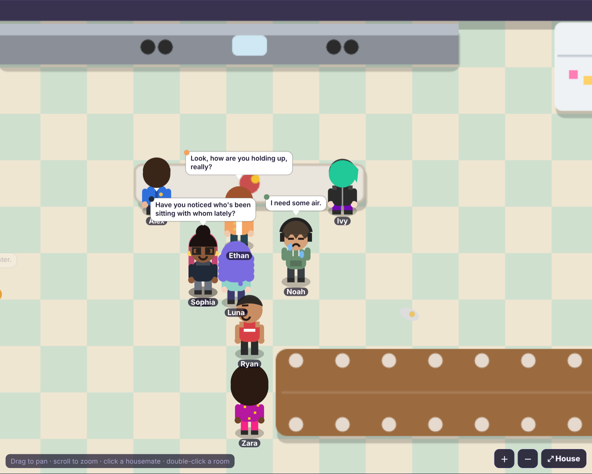 14:53: Noah in tears; Ethan: "how are you holding up, really?"</td>
<td>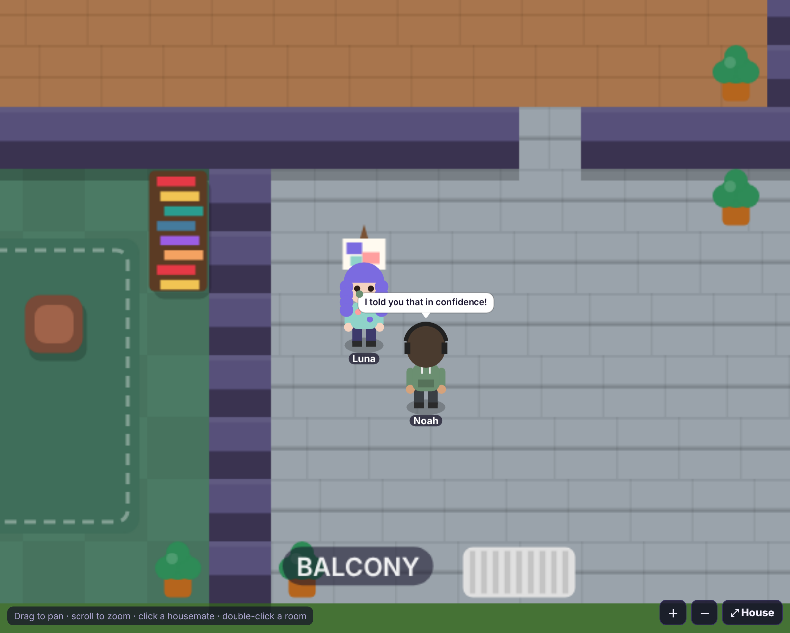 15:26: "I told you that in confidence!"</td>
</tr></table>

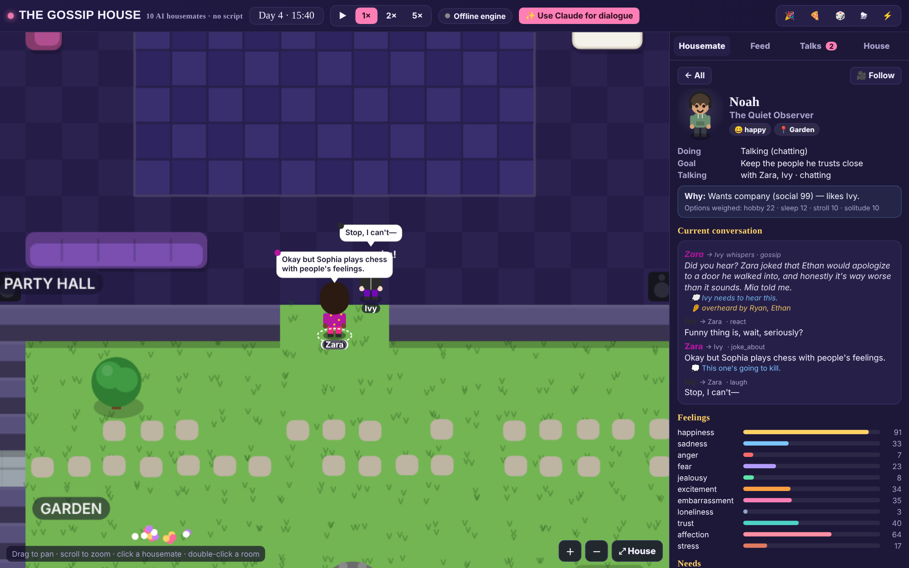
*The observer panel right after the confrontation. It shows Noah's emotions and needs, his relationships, his own secrets (and who he told them to), what he knows with its sources and certainty, and his memory: "Max knows my secret… I think Luna told people. I trusted them."*

Notice what Noah *doesn't* know: the observer can see the real chain (overheard → Mia → Sophia, Max → Zara), but that information never reaches the agents. And Ivy, the person this secret is about, is the only housemate who never heard it (see the secret-spread chart below).

---

## 2. Character by character

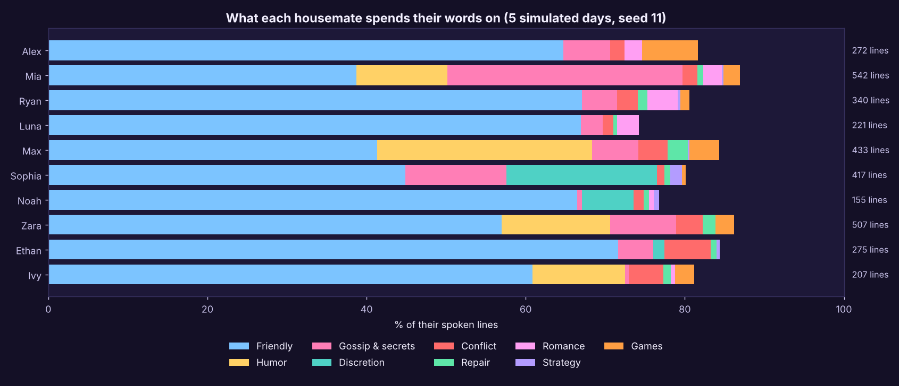

| Housemate | Lines | Conversations | What they actually did |
|---|---|---|---|
| **Alex**, the Leader | 272 | 46 | Hosted parties (Day 1, Day 2) and spent hours "planning the next big event". Watching rivals get popular made him jealous, and he vented it as **15 complaints about Zara behind her back**. They became the run's biggest feud: Alex → Zara ended at **resentment 80 with friendship 100**, a true frenemy. Never once gossiped about a secret. |
| **Mia**, the Gossip Queen | **542 (most)** | 72 | Shared gossip **107 times**, more than every other housemate put together. She exaggerated rumors as she retold them ("…and honestly it's way worse than it sounds") and was the first to leak Noah's secret. She also confessed her own crush on Ryan in Truth or Dare and flirted with him 13 times, with no couple forming in this seed. |
| **Ryan**, the Hothead | 340 | 47 | Reached the run's top anger (45). He **confronted** Mia and Max over things said behind his back, and then **forgave each of them**, just as his description ("can apologize after calming down") predicts. He confided his fear of betrayal to Max, and it later came out publicly in Truth or Dare. |
| **Luna**, the Emotional Artist | 221 | 43 | Spent more time on her hobby (painting on the balcony) than talking. Her confidants were Noah and Ethan. She kept every secret she was given and comforted Noah. She became jealous **twice** on hearing that Alex and Zara had been flirting, because of her own crush on Alex. |
| **Max**, the Comedian | 433 | 56 | Told **56 jokes and 61 roasts of people who weren't there**. Those roasts kept getting back to their targets, which led to **9 apologies** and a long list of reconciliations (Ethan forgave him twice). He spread Noah's secret to Zara. He confessed his failed audition during Truth or Dare. |
| **Sophia**, the Strategist | 417 | 58 | Played the long game: she formed **5 alliances** (Ryan, Max, Noah, Mia, Ethan), more than anyone else. She **cautioned** gossipers 79 times ("Are you sure that's even true?") while still sharing rumors herself (53), mostly strategic ones. She never revealed her ambition to anyone. |
| **Noah**, the Quiet Observer | **155 (fewest)** | 37 | Talked least and spent the most time on his own hobby. He kept Luna's secret for five days and confided only once, and that whisper got overheard. He was the only housemate whose crying lasted (24 minutes). Mia and Ethan each ran off in tears from an argument, but recovered alone. |
| **Zara**, the Party Star | 507 | **76 (most)** | Took part in the most conversations, started games, and told 28 jokes and 41 roasts. She was the target of Alex's complaints. She confessed in Truth or Dare that she's thinking of moving out. |
| **Ethan**, the Peacemaker | 275 | 54 | Gave the most compliments (44) and forgave Max repeatedly. He finished the run as the **most influential housemate** (influence 69.4), the peacemaker winning a popularity contest he never entered. He confided his resentment about being everyone's fixer to Luna and Max, and Sophia overheard it. |
| **Ivy**, the Wildcard | 207 | 35 | Kept her distance and joined groups on her own terms. She confided her anonymous blog only to Zara. She **never found out** that Noah has a crush on her. |

### Time use
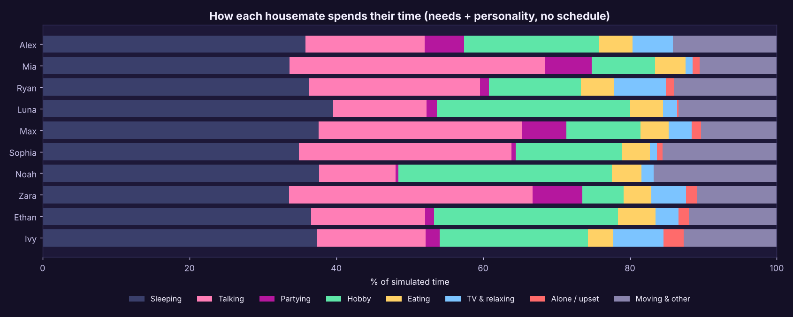
There is no schedule anywhere in the code. Needs (energy, hunger, social, fun, privacy) plus personality produce routines that look natural: introverts like Noah and Luna spend their days on hobbies and alone time, while Mia and Zara spend far more of theirs in conversation.

### Relationships after 5 days
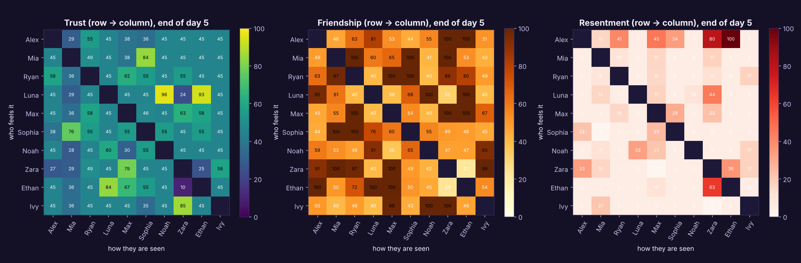
Read each row as "how this person feels about each column". The relationships are clearly **asymmetric**. For example:
- Alex → Zara: resentment 80, while Zara → Alex: resentment 33 (her trust in him did fall to 27).
- Noah → Luna: trust 60, while Luna → Noah: trust 96.

### Where the secrets went
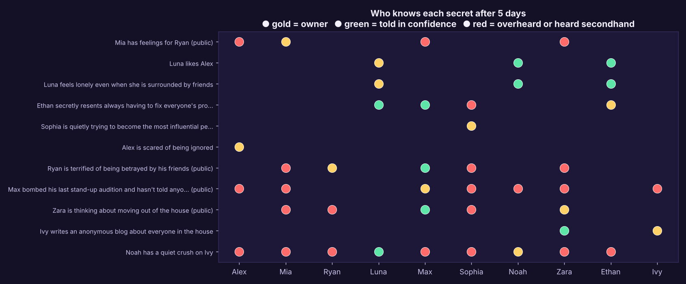
- **Kept:** Alex's fear, Sophia's ambition and Luna's crush never left their confidants.
- **Leaked:** Noah's crush reached 9 of the 10 housemates, everyone except Ivy, the person it's about.
- **Confessed:** four secrets became public through Truth or Dare. Those were the owners' own choices, so they don't count as betrayals.

---

## 3. A typical five days

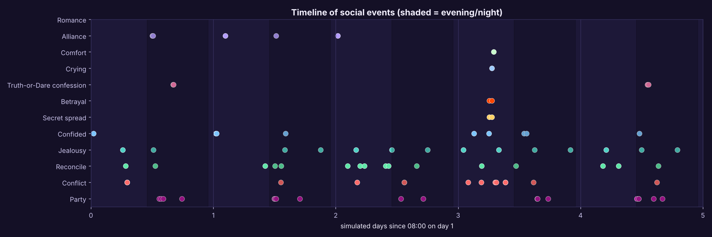

- **Parties every night.** Alex hosted Days 1 and 2, Mia Days 3 and 4, and Max Day 5. Peak crowds were 6–7, and nobody was forced to go: each housemate decided independently, after a personal delay, whether to attend.
- **Truth or Dare** started on its own at parties when ≥ 4 people were free in the hall. It produced 4 confessions.
- **Conflict and repair come in pairs:** 15 conflicts and 16 reconciliations. Most fights came from roasts and complaints made behind someone's back finding their way back to the person they were about.
- **Jealousy (14 events)** was driven mostly by the "Alex and Zara were flirting" rumor, which Mia had already exaggerated into "all over each other".

<table><tr>
<td>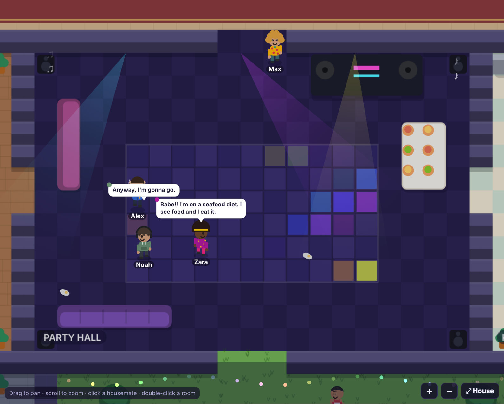 Day 1, 22:40: Alex's party in the Party Hall</td>
<td>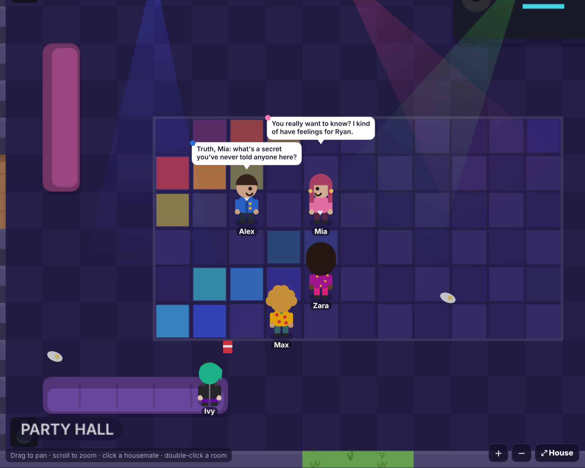 Day 2, 00:05: "You really want to know? I kind of have feelings for Ryan."</td>
</tr><tr>
<td>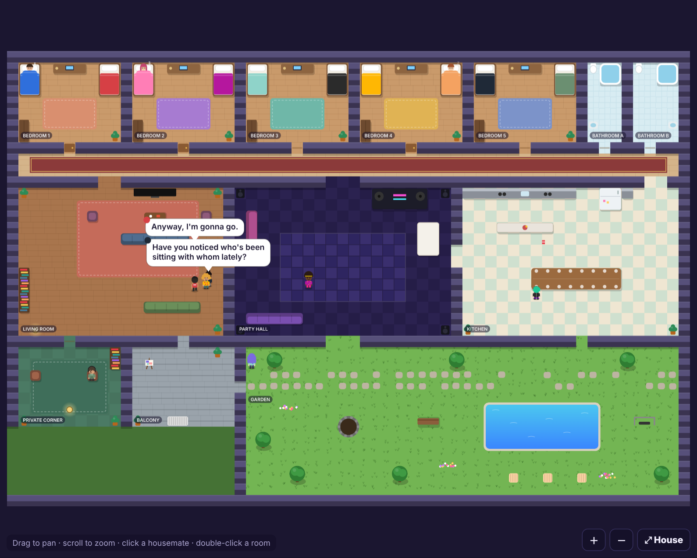 Day 1, 12:30: an ordinary lunchtime</td>
<td>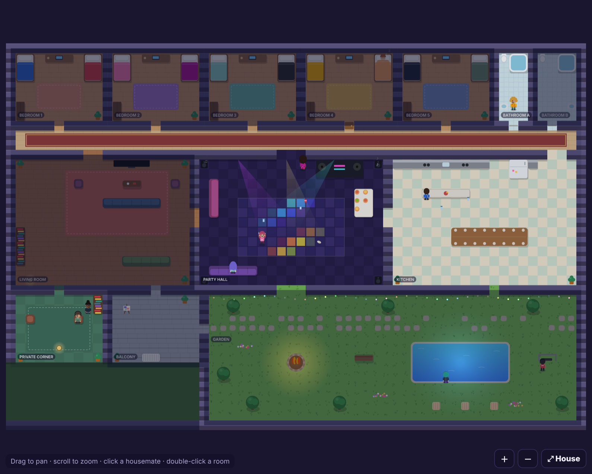 Day 3, 23:40: night; most bedrooms dark</td>
</tr></table>

---

## 4. Across many runs

The story changes with every seed, but the personalities stay recognisable. Across 10 seeds × 4 days (see [TEST_REPORT.md](TEST_REPORT.md)):
- Mia is consistently the top gossip and Max the top joker.
- Sophia consistently forms the most alliances.
- Noah consistently speaks least.
- Other seeds produced a **romance** (in seed 5 on an earlier build, Mia confessed in Truth or Dare, then Ryan found out, they flirted, and on Day 4 they became a couple), a **refused apology** (Alex refusing Zara's), and different housemates in tears: Max broke down in another seed, and in this run Mia and Ethan both "ran off in tears" from heated group arguments.

---

## 5. Honest weaknesses observed

| Observation | Cause | Possible fix |
|---|---|---|
| Friendship drifts to 100 for many pairs, even between rivals (Alex → Zara). | Every friendly line adds a little friendship, and friendship has no decay toward a neutral level. | Add slow decay toward a baseline and reduce gains from small talk. |
| Crowded group conversations churn: people leave and rejoin, and "I'll catch you later" appears very often. | Joining a nearby conversation scores high in crowded rooms, and leaving gets more likely as a conversation goes on. | A rejoin cooldown, or a cap on conversation size per room. |
| Housemates cluster on the same kitchen tiles. | When agents approach a moving target, they head for the same free tiles next to it. | Spread agents out when they stand idle in a conversation. |
| Offline lines repeat (for example "Have you noticed who's been sitting with whom lately?"). | The offline engine uses small template banks. | Connect Claude: each line is then generated from the full state. |
| Truth or Dare reveals secrets quite easily. | The bravery threshold is tuned for drama. | Make it depend on how trusting the people in the room are. |
